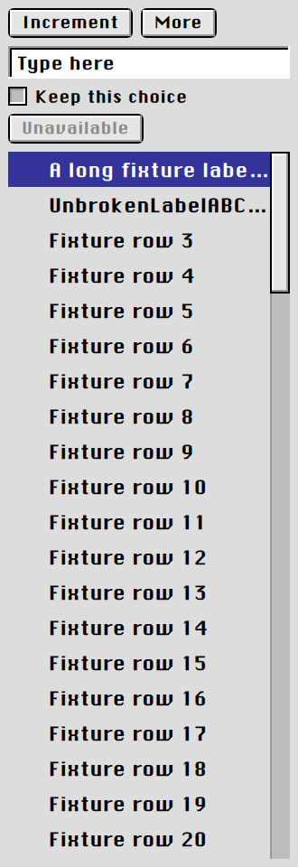
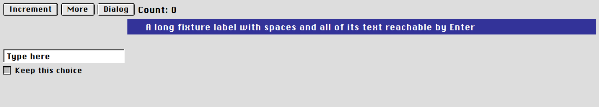
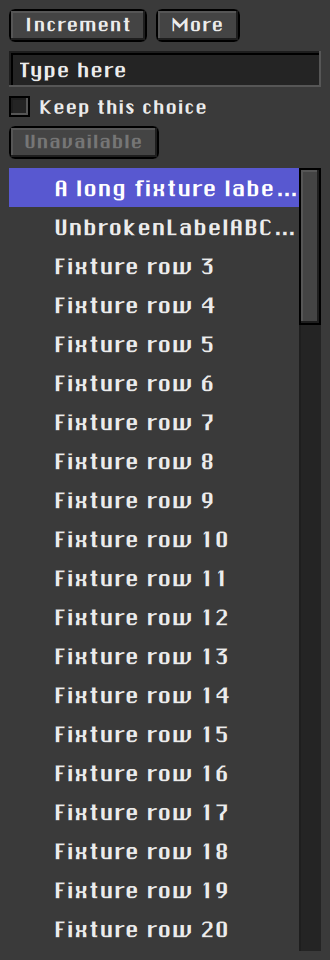
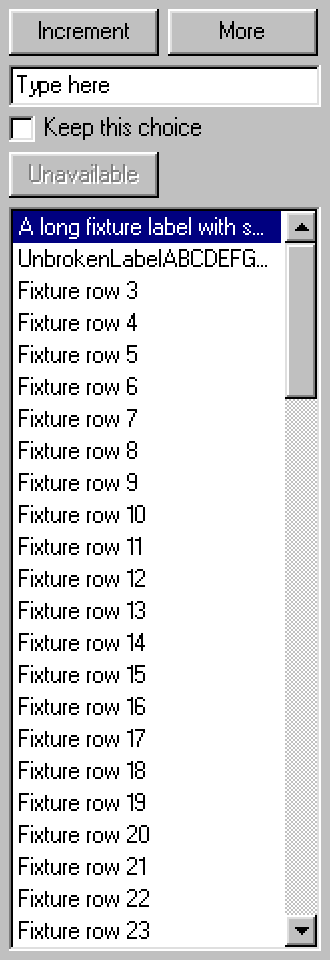
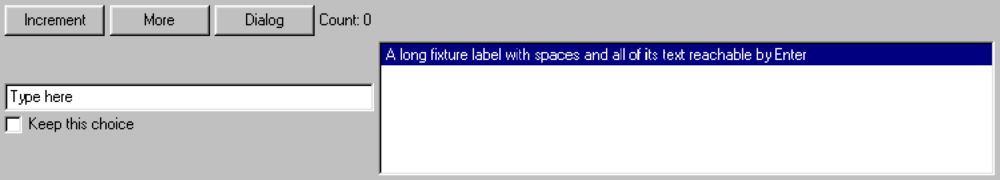
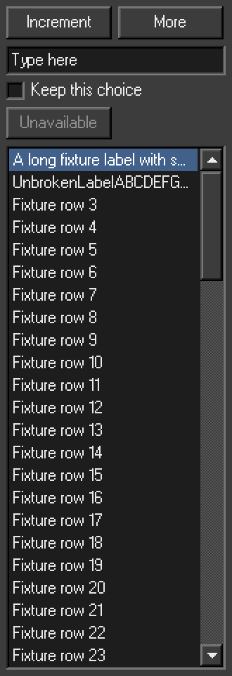
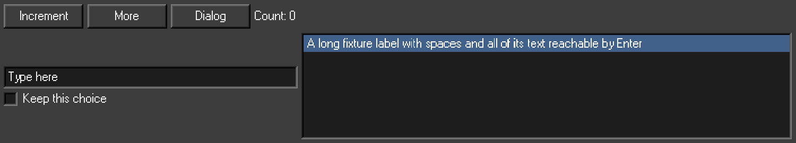

# Foundation review evidence

These are unchanged, after-only captures of the final wrapped demo at Hensou `ce52d4911b421983807065a7f34b59b75db91c51`. Aka generated them with Mesa llvmpipe. This documentation-only branch does not change either reviewed implementation branch or the Mountainous dependency pin.

The complete set shows all five appearances in narrow-tall and wide-short containers. A still shows appearance, not input timing or modal blocking. Source-tagged test traces remain on Aka. Read the attached independent reports for their scope and limits.

## Platinum

Light, narrow-tall:

Light, wide-short:

Dark, narrow-tall:

Dark, wide-short:

Extra dark, narrow-tall:

Extra dark, wide-short:

## Win98

Light, narrow-tall:

Light, wide-short:

Dark, narrow-tall:

Dark, wide-short:

## Independent review

- [SPEC review](review-report.md) returned OK with notes and no must-fix findings.
- [Standards review](standards-report.md) returned OK with notes and no P0/P1 findings.

The reports cover Hensou `ce52d4911b421983807065a7f34b59b75db91c51` and Mountainous `429802b7b0dba840701df436c84df31cf5059173`. Their P2 follow-ups remain open. Mountainous's web-theme check also remains red, with the same color mismatch reproduced on its original baseline. Neither review claims deployment proof or exact Platinum shell pixel identity.
